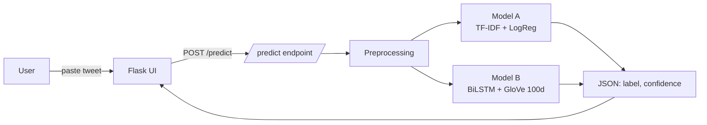
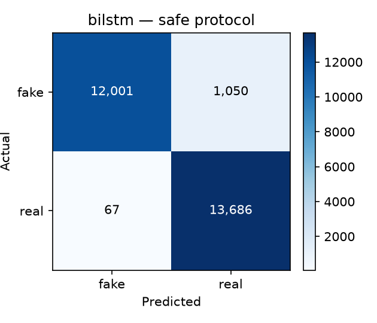
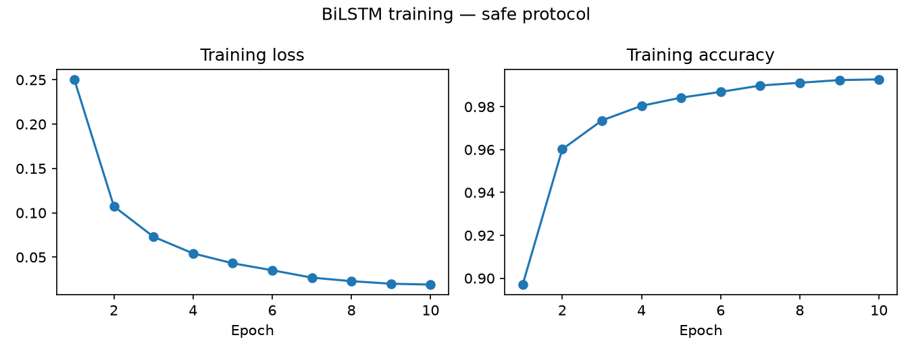

# TweetGuard — Fake Tweet Detection

[](https://github.com/Only-A7med/Fake-Tweets-Detection/actions/workflows/ci.yml)
[](LICENSE)

Companion code for the IEEE paper:

> A. Tariq, S. I. Khan, M. Imran, A. Mustafa and Z. Elgamal, "Fake Tweets Detection using Bi-LSTM
> with GloVe Embedding," in *2025 International Conference on Computational Intelligence and
> Knowledge Economy (ICCIKE)*, Dubai, United Arab Emirates, 2025, pp. 737–742,
> doi: [10.1109/ICCIKE67021.2025.11318261](https://doi.org/10.1109/ICCIKE67021.2025.11318261).
> IEEE Xplore: [ieeexplore.ieee.org/document/11318261](https://ieeexplore.ieee.org/document/11318261)

Two models trained on the [TruthSeeker 2023](https://www.unb.ca/cic/datasets/truthseeker-2023.html)
dataset classify tweets as **real** or **fake**: a TF-IDF + Logistic Regression baseline and the
paper's primary BiLSTM + GloVe model, served side by side from a small Flask app.

## Research Team

Authors of the ICCIKE 2025 paper, in published order.
Affiliations use each institution's current official name.

| # | Author | Affiliation | Profile |
|---|---|---|---|
| 1 | Anees Tariq | Department of Robotics & Artificial Intelligence, SZABIST University, Islamabad, Pakistan | [IEEE Xplore](https://ieeexplore.ieee.org/author/681085073589134) |
| 2 | Saad Irfan Khan | Department of Robotics & Artificial Intelligence, SZABIST University, Islamabad, Pakistan | [IEEE Xplore](https://ieeexplore.ieee.org/author/956386687115951) |
| 3 | Muhammad Imran | Department of Robotics & Artificial Intelligence, SZABIST University, Islamabad, Pakistan | [IEEE Xplore](https://ieeexplore.ieee.org/author/379555213025616) |
| 4 | Ahmad Mustafa | School of Computing, Skyline University College, UAE | [IEEE Xplore](https://ieeexplore.ieee.org/author/37088568836) · [ORCID](https://orcid.org/0009-0000-6429-9070) · [GitHub](https://github.com/Only-A7med) |
| 5 | Dr. Zenab Elgamal | School of Computing, Skyline University College, Dubai, UAE | [IEEE Xplore](https://ieeexplore.ieee.org/author/37088536515) |

## Architecture



## Results

**Paper vs. this repo.** The paper reports **98.1%** (LogReg) and **98.2%** (BiLSTM) accuracy on a
40,000-tweet test split. The numbers below are this repo's retrained results — reported honestly,
never substituted with the paper's.

This repo evaluates under **two protocols**:

- **paper** — augment to 200k rows first, then split 80/20, exactly as the paper describes.
  Word-swapped variants of one source tweet can land on both sides of the split, so some training
  information leaks into the test set.
- **leakage-safe** — split original tweets 80/20 first, then augment only the training side.
  Every test row is an unmodified tweet never seen (even as a variant) in training. These are the
  honest generalisation numbers, and the set the Flask app serves by default.

| Protocol | Model | Accuracy | Precision | Recall | F1 | Test n |
|---|---|---|---|---|---|---|
| paper | TF-IDF + LogReg | 97.2% | 0.9714 | 0.9746 | 0.9730 | 40,000 |
| paper | BiLSTM + GloVe | 96.8% | 0.9751 | 0.9632 | 0.9691 | 40,000 |
| leakage-safe | TF-IDF + LogReg | 97.7% | 0.9762 | 0.9799 | 0.9780 | 26,804 |
| leakage-safe | BiLSTM + GloVe | 95.8% | 0.9287 | 0.9951 | 0.9608 | 26,804 |

Confusion matrices and training curves are generated into `reports/figures/` by
`python -m src.training.evaluate`.

<p>
  
  
</p>

## Quickstart

```bash
python -m venv .venv
.venv\Scripts\activate            # Windows; on Linux/macOS: source .venv/bin/activate
pip install -r requirements-dev.txt

# 1. Data (TruthSeeker 2023 via Kaggle — public, no API key needed)
python -m src.data.download --glove
python -m src.data.preprocess                  # paper protocol -> train.csv/test.csv
python -m src.data.preprocess --leakage-safe   # safe protocol  -> train_safe.csv/test_safe.csv

# 2. Train (baseline: ~1 min; BiLSTM: ~15 min/protocol on CPU)
python -m src.training.train_baseline
python -m src.training.train_bilstm

# 3. Evaluate -> metrics table + reports/figures/
python -m src.training.evaluate

# 4. Serve the app -> http://localhost:7860
python -m src.app.app
```

### API

```bash
curl -X POST http://localhost:7860/predict \
  -H "Content-Type: application/json" \
  -d '{"text": "The Federal Reserve raised interest rates on Wednesday."}'
```

```json
{
  "predictions": [
    {"model": "baseline", "label": "real", "confidence": 0.9859, "p_real": 0.9859},
    {"model": "bilstm",   "label": "real", "confidence": 1.0,    "p_real": 1.0}
  ],
  "protocol": "safe",
  "text": "The Federal Reserve raised interest rates on Wednesday."
}
```

## Experiment tracking

Training runs are tracked with MLflow (local `sqlite:///mlflow.db` store): hyperparameters,
per-epoch curves, test accuracy, and artifacts. Inspect them with `mlflow ui`. LSTM width was
varied to sanity-check the paper's architecture choices (see `--lstm-units` /
`--dense-units` / `--no-save` on `train_bilstm`).

### Provenance of the published results

The results table above was first measured in an earlier training round **whose MLflow store was
not preserved**, so those numbers carried no run identifiers. All four models were therefore
retrained from scratch with the same code, the same `src/config.py` and seed 42, and the retrained
metrics reproduced the committed figures **exactly** — every one of the 24 fields in
`reports/metrics.json`, at full floating-point precision, and the six figures in
`reports/figures/` byte for byte. The table is unchanged; it now has traceable provenance:

| Protocol | Model | MLflow run | Training time |
|---|---|---|---|
| paper | TF-IDF + LogReg | `204879f821a54d9085c7e8e0f0103cf1` | 32.1 s |
| paper | BiLSTM + GloVe | `3ffff24580444d2ba6bcfb64269edb65` | 19.5 min |
| leakage-safe | TF-IDF + LogReg | `22ac0f6d2ab04f259b2c45e3b66d54db` | 34.6 s |
| leakage-safe | BiLSTM + GloVe | `5bc1da65ad18400d804c6f122a575af1` | 18.6 min |

Measured on an Intel Core i5-13500H (12 cores / 16 threads), 15.6 GB RAM, **CPU only**, Python
3.11.9 with TensorFlow 2.21.0, Keras 3.15.1, NumPy 2.4.6 and scikit-learn 1.9.0. The MLflow store
is local and not committed.

Those exact artifacts are published in the private model repository
[`Only-A7med/fake-tweets-detection`](https://huggingface.co/Only-A7med/fake-tweets-detection) at
revision `5624bbdaafe313bfc14c6d00d50a6ef274c03357`; its model card repeats these numbers next to
the data and embedding licences. They are the first weights ever published for this project.

## Deployment (tooling only — no public demo yet)

**There is no public demo.** No Hugging Face Space has been created, so nothing is deployed and
there is no hosted endpoint to try. What exists is the deployment tooling: the Docker image, the
start-up artifact download, and the upload script. Deploying a Space is planned for a later pull
request.

The image never contains the model weights; they are pulled at container start from a Hugging Face
model repository:

```bash
# one-time: upload trained artifacts (needs `hf auth login` with a write token)
python scripts/upload_artifacts.py --repo Only-A7med/fake-tweets-detection
```

The trained artifacts live in the **private** model repository
[`Only-A7med/fake-tweets-detection`](https://huggingface.co/Only-A7med/fake-tweets-detection), so
the start-up download needs a read token for it. To run the container, set
`TWEETGUARD_MODEL_REPO=Only-A7med/fake-tweets-detection`:

```bash
docker build -t tweetguard .
docker run -p 7860:7860 -e TWEETGUARD_MODEL_REPO=Only-A7med/fake-tweets-detection tweetguard
```

The YAML front-matter at the top of this README is Space configuration (Docker runtime, port 7860),
kept ready for that later deployment.

## Repository layout

```
src/
├── data/        # download (kagglehub + GloVe), preprocessing + augmentation, split
├── models/      # baseline pipeline, BiLSTM architecture, unified predict API
├── training/    # train_baseline, train_bilstm, evaluate (all MLflow-tracked)
└── app/         # Flask app: UI, /predict, /health, startup artifact download
scripts/         # upload_artifacts.py (one-time HF Hub upload)
notebooks/       # EDA on TruthSeeker 2023
tests/           # 75 tests, 87% coverage on src/
```

## Reproducibility notes

- Seeds fixed at 42 (numpy, tensorflow, random, sklearn) everywhere.
- Dataset and GloVe embeddings are never committed; download scripts cache them outside the repo.
- Hyperparameters not specified in the paper (LSTM units, vocab size, sequence length, batch
  size) are marked as such in `src/config.py`.
- The paper's augment-then-split protocol is reproduced as published; the leakage-safe protocol
  exists because the honest generalisation number is the one worth quoting.

## License

[MIT](LICENSE) — the paper itself is © IEEE.
